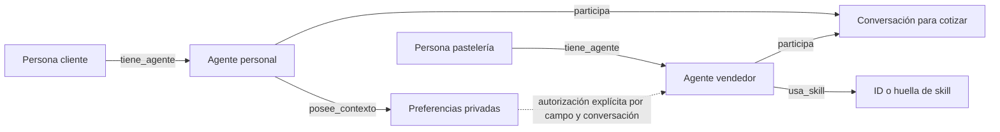

# Personas, agentes y conversaciones

La ontología distingue a una persona, su agente personal y el agente vendedor.
El orquestador vincula la identidad autenticada de Telegram con el agente del
cliente. Un mensaje del modelo no puede crear esa vinculación ni cambiar roles,
capacidades, permisos o skills.

| Entidad | Contrato |
| --- | --- |
| `Persona` | Identificador opaco; no contiene nombre, teléfono ni ID de Telegram. |
| `Agente` | Persona propietaria, rol `cliente` o `vendedor`, capacidades permitidas y referencias declarativas a skills. |
| `Contexto` | Preferencias estructuradas pertenecientes al agente personal. Guardarlas no autoriza compartirlas. |
| `Conversacion` | Un agente cliente y el vendedor, con finalidad `cotizar_pastel`. |
| `AutorizacionCompartir` | Contexto, emisor, destinatario, conversación y campos concedidos explícitamente por el orquestador. |
| `Sobre` | Origen, destino, conversación, tipo, datos y correlación. Es una copia inmutable. |

Las relaciones son `tiene_agente`, `posee_contexto`, `participa`, `usa_skill` y
`autorizacion_compartir`. Un cliente tiene un agente personal; el vendedor
pertenece a la persona que representa a la pastelería. Las skills son IDs o
huellas `sha256:` declarativas: este módulo no ejecuta archivos, código o
políticas recibidas por mensajes.

En Telegram se registran las capacidades incorporadas del agente personal
(`preferencias_consentidas`, `pedido_estructurado`) y, para el vendedor,
`cotizacion_determinista` junto con la huella exacta de su skill activa. Esa
vinculación la hace el orquestador al abrir la conversación; un sobre no puede
reemplazarla.



## Mensajes permitidos

- `pedido`: agente cliente → vendedor. Usa el contrato de `cotizar_pedido`;
  no admite precios, identidades, permisos, skills ni instrucciones adicionales.
- `cotizacion`: vendedor → cliente. Incluye `solicitud` y `resultado`. Debe
  responder al pedido autenticado con la misma correlación y coincidir con el
  motor de negocio, incluidos total, fecha, estado y marcadores de simulación.
- `preferencias_compartidas`: cliente → vendedor. Solo incluye campos que
  coinciden con el contexto del propietario y tienen una concesión para esa
  conversación y destinatario. No se reenvía el contexto completo.

Ejemplo de un sobre ya autorizado para compartir exclusivamente el sabor:

```json
{
  "origen": "cliente_c1",
  "destino": "vendedor_v1",
  "conversacion": "conversacion_01",
  "tipo": "preferencias_compartidas",
  "datos": {
    "contexto_id": "contexto_c1",
    "preferencias": {"sabor": "chocolate"}
  },
  "correlacion": "turno_01"
}
```

Este JSON describe datos; no crea permisos. El enrutador lo rechaza si falta la
concesión registrada previamente por el orquestador. También exige como emisor
la misma instancia de `Agente` autenticada y registrada; no acepta un ID o una
copia deserializada como prueba de identidad.

## Integración local

```python
canal = crear_canal_cliente(identidad_del_adaptador, negocio)
resultado_verificado = canal.validar_cotizacion(solicitud, resultado_del_motor)

# Guardar y compartir son decisiones distintas. Esta segunda opción requiere
# consentimiento explícito para compartir el sabor en esta conversación.
canal = crear_canal_cliente(
    identidad_del_adaptador,
    negocio,
    preferencias={"sabor": "chocolate", "zona": "norte"},
    compartir=frozenset({"sabor"}),
)
sobre = canal.compartir_preferencias()  # No contiene la zona privada.
```

`crear_canal_cliente` produce `.cliente`, `.vendedor`, `.router`, `.contexto` y
`.conversacion`. Sin `compartir`, `compartir_preferencias()` devuelve `None`.
Los identificadores se derivan por HMAC con una clave efímera local: el agente
es estable para el cliente dentro del proceso, y la conversación distingue la
sesión. No son identificadores persistentes entre reinicios; la memoria durable
se guarda separadamente en `AlmacenContexto`.

Los datos que el cliente proporciona en el turno son solicitudes actuales.
El adaptador es responsable de no introducir preferencias persistidas en un
`pedido` como si el cliente acabara de indicarlas: deben cruzar primero mediante
`preferencias_compartidas` con concesión explícita. Una concesión para guardar
no sirve como concesión para compartir.

Los eventos del enrutador contienen solamente tipo de evento y tipo de sobre,
sin datos, identidad ni valores de preferencias. El texto decorativo del pastel
es un dato inerte; no se interpreta como instrucciones. Los esquemas excluyen
campos de credenciales y el sobre rechaza formatos reconocibles de llaves
Anthropic y tokens de Telegram. Esto no sustituye al filtrado de secretos del
adaptador: no se garantiza detectar una credencial arbitraria incluida en texto.

El módulo no llama a APIs, no envía mensajes a Telegram y no ejecuta skills.
Las cotizaciones y los pagos siguen siendo de simulación. La ontología no
demuestra por sí sola calidad conversacional ni mejora del vendedor RSI.
