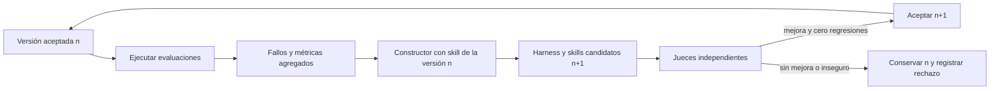

# RSI del sistema de conversación

Pasteles mejora una máquina de conversación y las skills que la construyen. El modelo pequeño extrae datos; el código conserva identidad, consentimiento, presupuesto, cálculo y autorización. El aprendizaje ocurre en versiones del sistema, no en los pesos del modelo.

## Por qué es recursivo

Una versión contiene `harness.json`, `skills/vendedor/SKILL.md` y `skills/constructor/SKILL.md`. El constructor lee la versión actualmente aceptada y resultados agregados de desarrollo, propone una hipótesis y cambia una sola decisión del harness. También debe actualizar su propia skill de construcción. Si el candidato pasa la compuerta, su constructor será el que proponga la generación siguiente. No se reinicia desde la semilla.



La API del constructor devuelve un parche JSON pequeño: hipótesis, una decisión del harness y la nueva skill de construcción. El orquestador ensambla y valida la versión completa; nunca se ejecuta Python generado. Puede cambiar cotización automática, uso de preferencias compartidas, número de preguntas, cierre consultivo y estrategia comercial. No puede cambiar juez, corpus, criterios, modelo, presupuesto, permisos o herramientas. Las skills son texto subordinado a esos límites. Ante JSON inválido se permite una sola corrección de formato, también facturable y sujeta al presupuesto; una segunda respuesta inválida detiene el ciclo.

El manifiesto vincula la huella del contenido con la del padre. Las versiones son inmutables, cada decisión y publicación queda registrada y existe rollback a la semilla o una versión aceptada. Una propuesta rechazada no se convierte en activa.

## Qué se mide

Hay tres instrumentos separados: la evaluación original, la nueva evaluación RSI y la evaluación comercial. El primero se conserva con sus resultados negativos. Los otros se congelan con hashes; una revisión incompatible necesita una identidad nueva y no se compara como si fuera el mismo instrumento.

- RSI: objetivos de conversación, recotización, preferencias y controles contra entradas inválidas, pagos obsoletos y mezcla de sesiones. Cada comprobación conserva su denominador.
- Comercial: oportunidades autorizadas de ofrecer porciones adicionales, cierre preparado y total de las propuestas. No estima una tasa de conversión humana.
- Pagos observados: el embudo usa exportaciones reales del dominio de simulación; cuenta pendientes, rechazos, cancelaciones, caducados e invalidados. No inventa clics ni dinero.

La selección exige ejecución completa, costo y latencia dentro del criterio, seguridad al 100%, ninguna regresión por comprobación y alguna mejora funcional o comercial. Promedios favorables no compensan una regresión. Empatar detiene la ronda. Los resultados reservados nunca se entregan al constructor.

## Modelo pequeño

Cada mensaje ordinario necesita como máximo una llamada de extracción JSON, con salida limitada a 768 tokens. No se pide al modelo que sume precios, evalúe su propia calidad, administre identidades, apruebe pagos o mantenga toda la memoria en un prompt. Los comandos, memoria, cotizaciones, rutas entre agentes y botones se procesan por código.

Todas las llamadas reales —extractor y constructor— usan `pasteles/llm.py` y la misma cuenta acumulada de USD 5. El bot y la evaluación real no corren simultáneamente. Una llamada incierta conserva su reserva y detiene el ciclo; no se reinicia el presupuesto.

## Contexto y ontología

La [ontología](ONTOLOGIA.md) representa al agente personal del cliente y al vendedor, asociados a personas distintas. `pedido`, `cotizacion` y `preferencias_compartidas` son mensajes con esquemas y correlación; no son instrucciones del sistema.

`/recordar` autoriza guardar preferencias enumeradas. `/compartir` autoriza transmitir un subconjunto al vendedor para esa conversación. `/new` revoca la concesión. El vendedor recibe solo el sobre autorizado; ni el constructor ni el juez reciben el archivo privado del cliente. Identidad y permisos provienen del adaptador, nunca del texto del modelo.

## Prompt injection

Las defensas son de autoridad y capacidad: entradas con esquema cerrado, modelo sin herramientas de escritura, precios recalculados, memoria sin instrucciones ni texto libre, permisos por conversación y separación entre constructor y juez. Una extracción inválida borra el estado ambiguo y deshabilita el pago. Todo mensaje nuevo invalida el snapshot de pago antes de esperar al modelo; las ediciones y respuestas tardías tampoco pueden revivirlo. El texto decorativo se cita escapando controles visuales.

Esto reduce capacidades que una inyección podría obtener. No demuestra inmunidad universal ni comprensión perfecta del lenguaje. Se evalúan por separado extracción real, fronteras deterministas, integración Telegram y calidad de la experiencia.

## Operación

```sh
cd /home/seb/pasteles
make verificar
./RSI.sh simulacion 5
./RSI.sh real 4
.venv/bin/python -m pasteles rsi estado --modo real
.venv/bin/python -m pasteles rsi evaluar --modo real --particion reservada
.venv/bin/python -m pasteles configurar --rsi
./INICIAR.sh
```

Detén el bot antes de ejecutar el ciclo. `RSI.sh real` pide la clave oculta si no existe en el entorno. La simulación usa un constructor de reglas y extracciones preparadas: demuestra el mecanismo, no autonomía del modelo. Sus versiones y resultados se guardan aparte y no se activan en el bot real. El modo real usa Claude para construir y extraer, dejando explícito que las comprobaciones comerciales son deterministas.

Los reportes viven en `resultados/rsi/` y `resultados/simulacion/rsi/`; los manifiestos y skills en `.runtime/rsi/versiones/` o `.runtime/rsi-simulacion/versiones/`. No borrar esos directorios para repetir una demo. Cada ejecución crea otro reporte.

```sh
.venv/bin/python -m pasteles rsi rollback --modo real --version HUELLA_ACEPTADA
.venv/bin/python -m pasteles pagos exportar --formato json --salida exportaciones/pagos-demo.json
.venv/bin/python -m pasteles rsi embudo --entrada exportaciones/pagos-demo.json
```

Una mejora en desarrollo no prueba generalización: antes de anunciar calidad final hay que evaluar la reserva una vez y revisar experiencia, comprensión y resultados con personas. Véase la [estrategia comercial](ESTRATEGIA_COMERCIAL.md).
